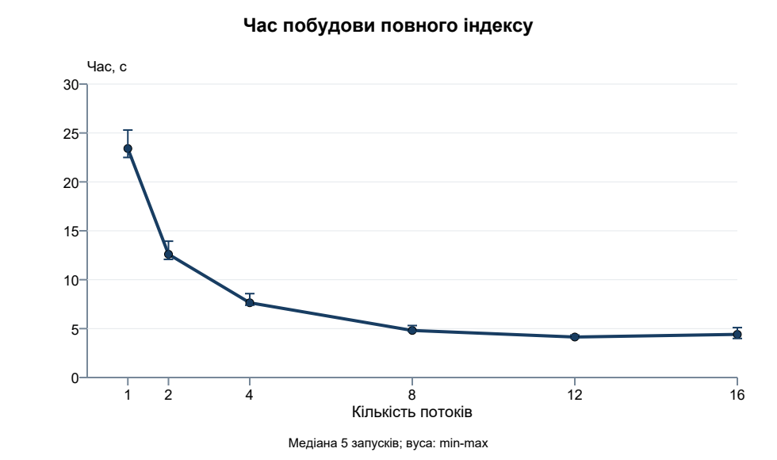
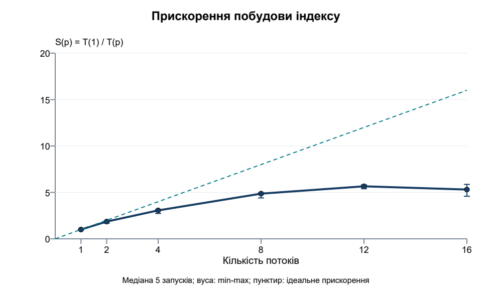
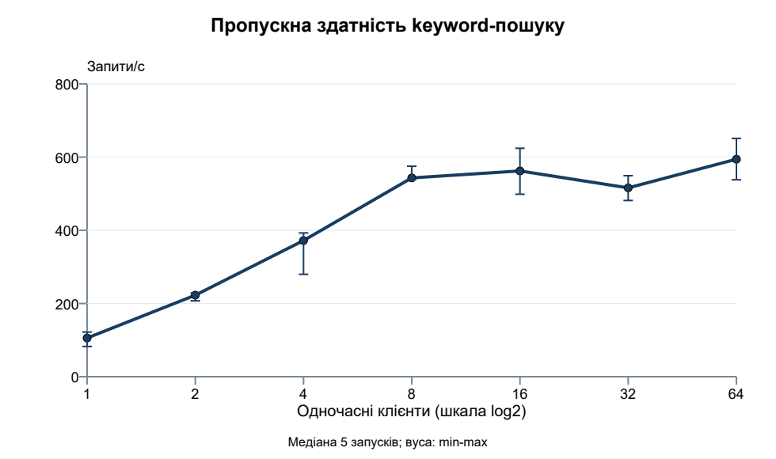
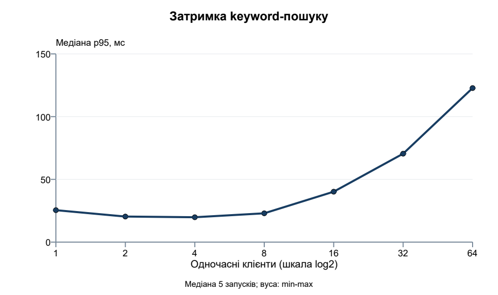

# Результати дослідження масштабованості

Дата: 2026-11-23. CPU: AMD Ryzen 5 5600H with Radeon Graphics; 12 логічних CPU, 7.44 GiB RAM у Docker.
Корпус: 12000 документів, 2462028386 байтів, seed=20240517.
Один неврахований прогрів і п'ять повторень на точку; прогрітий кеш ОС.
Стовпчики min-max зберігають усі повільні запуски. Параметри середовища, стан Git і digest образу: [environment.json](../bench/results/environment.json). Методика: [bench/README.md](../bench/README.md).

## E1. Побудова повного індексу

| Потоки | Медіана, с | Min-max, с | Прискорення | Ефективність, % |
|---:|---:|---:|---:|---:|
| 1 | 23.410 | 22.499-25.301 | 1.00 | 100.0 |
| 2 | 12.605 | 12.076-13.937 | 1.86 | 92.9 |
| 4 | 7.644 | 7.395-8.576 | 3.06 | 76.6 |
| 8 | 4.811 | 4.718-5.312 | 4.87 | 60.8 |
| 12 | 4.139 | 4.022-4.338 | 5.66 | 47.1 |
| 16 | 4.410 | 3.992-5.103 | 5.31 | 33.2 |

Найкраща медіана в цьому досліді: 4.139 с при 12 потоках, S=5.66. Зменшення часу підтверджено вимірюваннями.
Сирі дані: [e1.csv](../bench/results/e1.csv).

## E2. Пропускна здатність keyword-пошуку

Окремий сервер з QUERY_EXPANSION=false; звичайний Compose використовує true.
По 256 нових HTTP-з'єднань на повторення; p50/p95 — медіани метрик п'яти повторень.

| Клієнти | Запити/с | p50, мс | p95, мс | Помилки |
|---:|---:|---:|---:|---:|
| 1 | 105.6 | 7.8 | 25.5 | 0 |
| 2 | 222.8 | 7.9 | 20.4 | 0 |
| 4 | 372.0 | 9.8 | 19.8 | 0 |
| 8 | 543.1 | 13.1 | 23.0 | 0 |
| 16 | 562.2 | 26.4 | 40.2 | 0 |
| 32 | 515.9 | 59.2 | 70.5 | 0 |
| 64 | 594.2 | 101.6 | 122.8 | 0 |

Максимальна медіана: 594.2 запитів/с при 64 клієнтах. Після насичення throughput не зростає пропорційно клієнтам, а p95 збільшується.
Вісь кількості клієнтів на графіках — log2. Сирі дані: [e2.csv](../bench/results/e2.csv).

## E3. Аналіз вузьких місць

Побудова має послідовні перелік/сортування файлів, диспетчеризацію, публікацію та звільнення старого покоління. Популярні шарди і mutex метаданих створюють конкуренцію; важливі також алокації, пам'ять та I/O. S(p)<p узгоджується з моделлю Амдала, але не визначає окремо частку кожного чинника.

Під час пошуку довжини документів читаються під metadata mutex; postings копіюються, всі кандидати сортуються до вибору top-10. Це можливі причини насичення разом з CPU/пам'яттю та HTTP-клієнтом. Профілювання очікування блокувань не виконувалось: наведені причинні пояснення є гіпотезами за кодом і графіками.

Можливі наступні оптимізації: незмінні метадані snapshot, частковий top-K, інструментація блокувань. Їх ефективність потребує окремих вимірювань. Синтетичний корпус не моделює природні книги; частота CPU, температура й фонові процеси ОС не фіксувалися. LLM-throughput цим E2 не вимірюється.

## Тестові пошукові запити

| Запит | Очікування | Фактично | Результат |
|---|---|---|---|
| coral reef | Є збіги | 10 | Пройдено |
| quantum physics | Є збіги | 10 | Пройдено |
| ancient rome | Є збіги | 10 | Пройдено |
| deep ocean whale | Є збіги | 10 | Пройдено |
| galaxy telescope | Є збіги | 10 | Пройдено |
| zzzzunknowntermxyz | Немає збігів | 0 | Пройдено |

Контрольні фрази взято з manifest, невідомий токен — негативний випадок. Це перевірка відомих збігів, не оцінка precision/recall на незалежному корпусі. Повні фактичні результати: [search_cases.json](../bench/results/search_cases.json).
